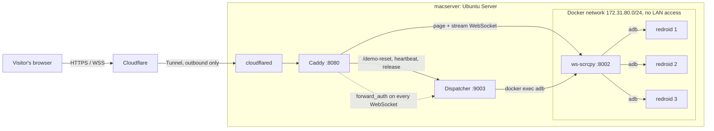

# Android Demo

Live Android app demos that run in the browser. Each visitor gets their own Android emulator,
streamed as video and controlled with the mouse or touch, with a freshly reset app. Nothing to
install.

Live: **https://demo-djbook.kantrybes.lt**, also embedded on [kantrybes.lt/dev](https://www.kantrybes.lt/dev).

The demos run on a home Linux server (an old MacBook Pro running Ubuntu Server) and are published
through a Cloudflare Tunnel, so the server has no open ports.

## How it works



1. The visitor opens the demo page (a custom `index.html` served by ws-scrcpy).
2. The page calls `POST /demo-reset`. The **dispatcher** picks a free emulator, wipes the app's data
   (`pm clear`), starts it, waits until it is actually on screen and returns
   `{udid, session}`. It also sets an `HttpOnly` session cookie.
3. The page switches to ws-scrcpy's stream view for that `udid`. The browser opens one WebSocket
   that carries the H.264 video and the touch input.
4. While the tab is open, the page sends a heartbeat every 30 s. When the tab closes it sends a
   release beacon. A phone without a heartbeat for 90 s, or held for 15 minutes, goes back to the
   pool.
5. When all phones are busy, the page shows a "busy" overlay and retries every 15 s.

### Components

| Part | What it does |
|---|---|
| [redroid](https://github.com/remote-android/redroid-doc) | Android 13 (x86_64) in Docker. One container per phone, 720×1600 at 280 dpi, Europe/Vilnius time zone. |
| [ws-scrcpy](https://github.com/NetrisTV/ws-scrcpy) | Runs scrcpy on the phones and streams them to the browser over WebSocket (MSE player). |
| `apps/djbook/www/index.html` | Replaces ws-scrcpy's start page: asks for a phone, shows a loading or busy overlay, keeps the lease alive and sizes the stream for high-DPI screens. |
| `demo-reset-server.py` | Dispatcher: phone leases, app reset, rate limits, and the WebSocket check for Caddy. Python standard library only. |
| Caddy | Local reverse proxy: routes the API, checks every WebSocket with the dispatcher, sets framing headers. |
| cloudflared | Publishes `demo-djbook.kantrybes.lt` without opening ports on the home router. |

## Repository layout

```
apps/djbook/
  docker-compose.yml   3 × redroid + ws-scrcpy on an isolated network
  www/index.html       custom ws-scrcpy start page
  reset-session.sh N   wipe and restart DJ Book on phone N (used by the dispatcher)
  launch-djbook.sh     shared "start the app and keep it in front" helper
  start-demo.sh        boot-time: wait for all phones, open the app
  connect-adb.sh       connect ws-scrcpy's adb to every phone
  install-apk.sh APK   install or update the APK on every phone
  deploy.sh            pull + apply everything on the server
demo-reset-server.py   dispatcher (systemd: demo-reset.service)
watch-adb.sh           cron, every 3 min: reconnect adb if a phone dropped
deploy/
  demo-reset.service   systemd unit for the dispatcher
  demo-firewall.sh     keeps the emulators off the LAN, tailnet and host
  demo-firewall.service
  macserver/Caddyfile  reference copy of /etc/caddy/Caddyfile
```

## Running it

Requirements: x86_64 Linux with the `binder_linux` kernel module, Docker with Compose, Caddy and
cloudflared. Each phone uses about 1.5 GB of RAM, and each viewer about 3–4 Mbit/s of upload.

One-time setup on the server:

```bash
# binder for redroid (survives reboots)
echo binder_linux | sudo tee /etc/modules-load.d/redroid.conf
echo 'options binder_linux devices=binder,hwbinder,vndbinder' | sudo tee /etc/modprobe.d/redroid.conf
sudo modprobe binder_linux devices=binder,hwbinder,vndbinder

sudo git clone https://github.com/tkestas92/android-demo.git /opt/android-demo
sudo chown -R "$USER": /opt/android-demo
git -C /opt/android-demo config core.fileMode false

# copy the APK (not in git) and start everything
cp Djbook.apk /opt/android-demo/apps/djbook/
bash /opt/android-demo/apps/djbook/deploy.sh --caddy
sleep 120 && cd /opt/android-demo/apps/djbook && ./install-apk.sh Djbook.apk && ./start-demo.sh

# reboot / self-healing
( crontab -l 2>/dev/null
  echo "@reboot sleep 60 && /opt/android-demo/apps/djbook/start-demo.sh"
  echo "*/3 * * * * /opt/android-demo/watch-adb.sh" ) | crontab -
```

Then add a Cloudflare Tunnel public hostname: `demo-djbook.kantrybes.lt` → `http://localhost:8080`.

Day to day:

```bash
ssh -t macserver "bash /opt/android-demo/apps/djbook/deploy.sh"   # after pushing changes
ssh macserver "cd /opt/android-demo/apps/djbook && ./install-apk.sh Djbook.apk"  # new APK
```

## Security

Visitors get remote control of real Android systems, so the setup assumes they will try to break
out of the app:

- **No open ports.** Caddy, the dispatcher, ws-scrcpy and adb only listen on localhost or the
  internal Docker network. The only way in is the Cloudflare Tunnel.
- **Only the video stream is reachable.** ws-scrcpy also ships an adb shell, Chrome devtools and a
  file browser. Caddy sends every WebSocket upgrade to the dispatcher (`forward_auth`), which allows
  exactly one kind: `action=proxy-adb&remote=tcp:8886` for the phone that the visitor's session
  cookie currently holds. Visitors cannot open a shell or watch someone else's phone.
- **Emulators are isolated from the LAN.** redroid needs privileged containers, so
  `demo-firewall.sh` drops their traffic to private ranges (home LAN, other Docker networks,
  Tailscale `100.64.0.0/10`) and new connections to the host. Internet access stays open for the
  app's API.
- **Abuse limits.** One IP can hold at most 2 phones and ask for at most 6 resets a minute.
  Leases expire on their own.
- **Fresh state.** Every visitor starts with wiped app data, so nothing a previous visitor did
  inside the app carries over.
- **Least privilege where possible.** The dispatcher runs with systemd sandboxing. It has no
  inputs that reach a shell: slot numbers come from a fixed list.

## Notes

- The MSE player is used because WebCodecs gave a black screen in some browsers.
- When `www/index.html` changes, ws-scrcpy has to be restarted, because a file bind mount keeps the
  old inode. `deploy.sh` does this.
- A visitor who reloads gets a new phone: the old lease is released on `pagehide`.
